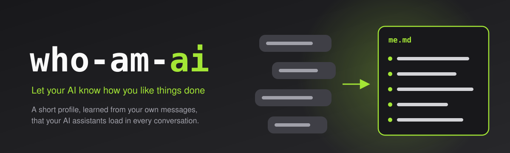
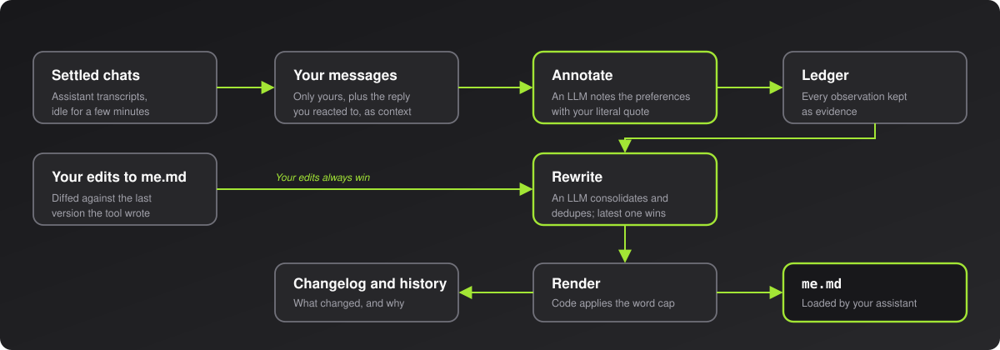

<p align="center">
  
</p>

<p align="center">
  <a href="https://github.com/caribeedu/who-am-ai/actions/workflows/tests.yml"></a>
  
  <a href="LICENSE"></a>
</p>

# who-am-ai

**Learns how you want AI assistants to work, from your own messages, and keeps a short profile that your assistants load in every conversation.**

> [!note]
> **Background:** who-am-ai is the lean successor of [Pythia](https://github.com/caribeedu/pythia), a broader knowledge oracle. Measuring Pythia showed that the clearest value came from its cheapest part: learning your preferences from your own messages. who-am-ai does only that. See [docs/decisions.md](docs/decisions.md).

Every new session starts blank, so you keep repeating the same things: reply in English, keep it short, do not paraphrase my request, no emojis in commits. who-am-ai reads what you say to your assistants, notes the preferences those messages reveal, and maintains a profile of about 600 words that the assistant loads into every conversation. You say it once; every assistant knows it from then on.

> [!IMPORTANT]
> **Supported today:** [Claude Code](https://claude.com/claude-code) as the assistant (its transcripts are the input, and the profile is imported through `CLAUDE.md`) and macOS as the platform (scheduling with a LaunchAgent, secrets in the Keychain). The design does not depend on either; other assistants and platforms are welcome additions.

## Features

- **Learns from what you actually say.** It reads only your messages, plus the tail of the reply you reacted to as context, so a short "no, in English" is understood. Assistant text never becomes a preference, and pasted material is ignored.
- **A high admission bar.** An item enters the profile only when it is general (it changes what an assistant does in unrelated tasks) and durable (a standing rule, or it recurs across chats). Details tied to one ticket or repository stay out.
- **You have the last word.** Edit `me.md` anywhere. Your edits are diffed against the last version the tool wrote and become observations with the highest authority, which no inference can override.
- **Every change is explained.** Each rewrite is stored with what was added, removed or changed and why (`whoamai log`), and every version of the profile is kept.
- **Small and predictable.** The profile has a word cap, enforced by code by priority: what you wrote, then what you repeated, then the most recent. There is no daemon, no Docker and no web server.
- **Bounded cost.** A monthly spend cap stops the LLM calls. A typical user spends a few dollars per month.
- **No LLM, no guessing.** Judgment is always done by an LLM; there are no heuristic fallbacks. Without a key or at the cap, runs stop and say so.

## How it works

<p align="center">
  
</p>

Once a day, `whoamai run` processes the conversations that have settled: it reads your new messages, asks an LLM to annotate the preferences they reveal (each with your literal quote), folds in your edits to `me.md`, asks an LLM to rewrite the item list (merging duplicates, the latest preference wins, you win over everything) and renders the result with the word cap applied. Details: [docs/design.md](docs/design.md).

## Getting started

**Requirements:** Python 3.13 or 3.14, [uv](https://docs.astral.sh/uv/) and an [Anthropic API key](https://console.anthropic.com/) for the LLM steps. Today the assistant is Claude Code and the platform is macOS (scheduling with a LaunchAgent, the key in the Keychain); on other systems you can run `whoamai run` yourself.

```bash
uv sync
```

```bash
uv run whoamai key
```

```bash
uv run whoamai install
```

`key` stores the API key in the Keychain (service `who-am-ai`). `install` schedules `whoamai run` once a day at 12:00 and makes Claude Code load the profile by adding `@~/.claude/me.md` to `~/.claude/CLAUDE.md`. To see the first result right away:

```bash
uv run whoamai run
```

### Commands

| Command | What it does |
|---|---|
| `whoamai run` | Process settled conversations and rewrite the profile if needed |
| `whoamai status` | Last run, spend this month, cap, observations and settings |
| `whoamai log [-n N]` | What changed in the profile, and why |
| `whoamai config` | Show settings |
| `whoamai config time 12:00` | Daily run time (updates the schedule) |
| `whoamai config cap 10` | Monthly spend cap in USD |
| `whoamai config read-mode mine\|mine+agent` | Read only your messages, or also the reply you reacted to, as context |
| `whoamai config exclude "<title prefix>"` / `include` | Leave conversations out by title prefix |
| `whoamai config models <annotate> <rewrite>` | Models per step (Sonnet by default) |
| `whoamai config max-words 600` | Profile size cap |
| `whoamai install` / `uninstall` | Add or remove the schedule and the import line |
| `whoamai import <file.json>` | One-time import of preferences from elsewhere |

State lives in `~/.who-am-ai/` (override with `WHO_AM_AI_HOME`).

## Development

The tests use a fake LLM and a temporary home, so they need no API key and no network.

```bash
uv sync
```

```bash
uv run python -m pytest -q
```

## Documentation

| Document | About |
|---|---|
| [Design](docs/design.md) | The pipeline, each piece, the runtime and the CLI |
| [Decisions](docs/decisions.md) | The numbered decisions (D1–D11) and the reasoning behind them |

## Privacy and security

who-am-ai reads your assistant transcripts (today, Claude Code's) locally and sends your messages, and the tail of the replies they react to, to the Anthropic API to annotate preferences. Nothing else leaves your machine. State is kept in `~/.who-am-ai/`, and the API key in the Keychain. See [SECURITY.md](SECURITY.md) to report a vulnerability and [CONTRIBUTING.md](CONTRIBUTING.md) to contribute.

## License

[MIT](LICENSE)
